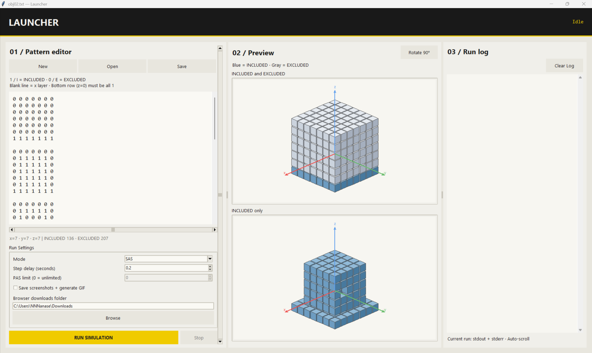
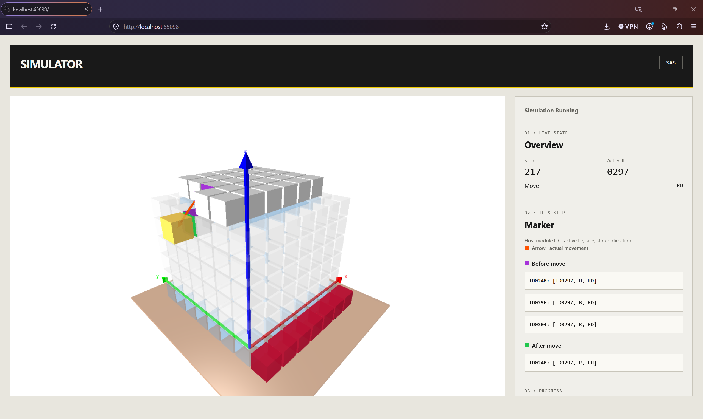
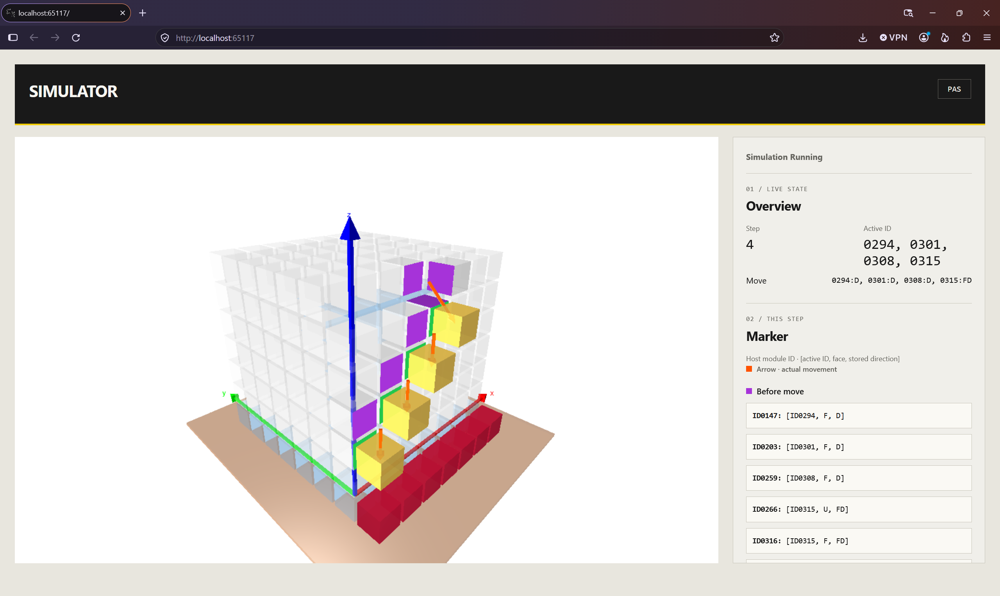

# Three-dimensional Self-Reconfiguration via Active Subtraction with Modular Robots

This repository contains simulator code for testing the SAS (Sequential Active Subtraction) and PAS (Parallel Active Subtraction) algorithms for three-dimensional modular robots proposed in the paper *Three-dimensional Self-Reconfiguration via Active Subtraction with Modular Robots*. 

This README introduces how to run the simulator and use its interface, and identifies where the main algorithms presented in the paper are implemented in the code.

---

## 1. Installation and Execution

### 1.1. Python and Virtual Environment Setup

The simulator has only been tested with Python 3.12 on Windows 11.

```cmd
winget install -e --id Python.Python.3.12
py -3.12 -m venv .venv
.venv\Scripts\activate
py --version
python -m pip install --upgrade pip
python -m pip install -r requirements.txt
```

### 1.2. Running the Main Simulator

```cmd
python main.py
```

By default, the launcher opens. From the launcher, users can edit or load patterns and configure the SAS/PAS mode, screenshot capture, the interval between steps, and other settings.

The simulator can also be run directly from the command line without using the launcher.

```cmd
python main.py path/to/pattern.txt SAS
python main.py path/to/pattern.txt PAS
```

The following example limits the number of concurrently active modules in PAS and runs the simulation without screen capture.

```cmd
python main.py path/to/pattern.txt PAS --pas-max-active 2 --no-capture
```

Omitting `--pas-max-active` allows the simulation to run without a limit on the number of concurrently active modules.

### 1.3. Running Auto Test

```cmd
python auto_test.py
```

Auto Test runs experiments using predefined settings and generates summaries and plots of the test results.

For details, see [5. Auto Test](#5-auto-test).

---

## 2. Launcher

The launcher is a Tkinter-based user interface. It does not affect the core algorithm logic.

It allows users to create, load, and save patterns, inspect a 3D pattern preview, and start SAS or PAS simulations after configuring settings such as screenshot capture and the interval between steps.



### 2.1. Interface Layout

| Area | Description |
|---|---|
| **Pattern Editor** | Creates, edits, and saves pattern files and configures execution settings. |
| **Preview** | Displays 3D previews of the full module configuration and the INCLUDED modules only. |
| **Run Log** | Displays standard output, error logs, and the termination status of the simulation process. |

In the pattern editor, `1`/`I` represents INCLUDED and `0`/`E` represents EXCLUDED. Blank lines separate individual yz-planes, and the rows in each block are written from the highest z-coordinate to the lowest. Every cell in the bottom row, corresponding to z = 0, must be INCLUDED.

### 2.2. Execution Settings and Controls

| Item | Description |
|---|---|
| **Mode** | Selects SAS or PAS. |
| **Step delay (seconds)** | Sets the delay between visualization steps. |
| **PAS limit (0 = unlimited)** | Sets the maximum number of concurrently active modules, A_max, in PAS. A value of `0` imposes no limit. |
| **Save screenshots + generate GIF** | Enables PNG capture at each step and GIF generation after the run finishes. |
| **Browser downloads folder** | Specifies the browser download folder where captured images are saved. |
| **RUN SIMULATION / Stop** | Starts or terminates the simulation process. |

---

## 3. Simulation Visualization

**Main file:** `main.py`, `visualizer_vpython.py`

The simulation interface uses VPython to visualize the three-dimensional structure. It was implemented to run in a web browser to support screenshot capture.

The visualization allows users to inspect INCLUDED and EXCLUDED modules, Active module movements, the Sink, and changes to Trémaux markings.




### 3.1. Interface Layout

| Element | Description |
|---|---|
| **3D Visualization** | Displays module types, positions, active states, and movements. |
| **Overview** | Displays the current step, Active module ID, and movement direction. |
| **Marker** | Displays changes to Trémaux markings before and after movement. |
| **Progress** | Displays the number of removed modules, remaining modules, the current working layer, and legal movement directions. |

### 3.2. Keyboard Controls

| Key | Function |
|---|---|
| `S` | Start, pause, or resume the simulation. |
| `N` | Advance the simulation by one step while paused. |
| `I` | Show or hide module IDs. |
| `C` | Rotate the camera by 90°. |
| `P` | Toggle the preview showing only INCLUDED modules. |

### 3.3. Main Methods

| File / Method | Description |
|---|---|
| `_visual_run_3d()` | Configures and runs the simulation instance and visualization environment. |
| `Visualizer.visual_run()` | Initializes the VPython interface and manages the simulation execution loop. |
| `Visualizer._visual_on_key()` | Handles keyboard input for execution control and display settings. |
| `Visualizer._visual_refresh()` | Updates the visualization to reflect the simulation state at each step. |
| `Visualizer._visual_capture_frame()` | Requests a PNG capture of the current screen when capture is enabled. |

Execution logs are saved by default in `runs/run_<timestamp>_<mode>_3d/`.

When capture is enabled, the PNG files generated in the browser download folder are moved together into the corresponding run directory after the simulation ends, and `simulation.gif` is generated.

---

## 4. Algorithm Implementation

The following sections map the SAS Leader, SAS Active, and PAS Leader pseudocode presented in the paper to their main implementation methods.

### 4.1. SAS Leader

**Paper:** Leader module in SAS  
**Main files:** `leader_3d.py`, `grid_3d.py`, `simulator.py`

The SAS Leader searches for movable EXCLUDED modules layer by layer and determines the order in which modules are activated.

| Method | Description |
|---|---|
| `Leader.select_next_module()` | Returns the next module to activate. |
| `Leader._run()` | Implements the core SAS Leader algorithm. Uses stack frames to traverse layers, reverse the search direction, and revisit previous layers. |
| `Leader._layers()` | Constructs the sequence of layers containing EXCLUDED modules within a height range, in DOWN or UP order. |
| `Leader._drain_layer()` | Finds and repeatedly selects movable EXCLUDED modules in a given layer. |
| `Grid.get_free_faces()` | Evaluates the module selection condition based on the number of exposed faces. |
| `Leader._spiral_order()` | Orders candidate modules according to a rectangular spiral in the XY plane. |
| `Leader._has_movable_excluded()` | Checks whether movable EXCLUDED modules remain within a specified layer range. |
| `Simulator._simulator_step_impl()` | Activates the module selected by the Leader, applies movement, and removes the module upon arrival at the Sink. |

### 4.2. SAS Active

**Paper:** Active Module  
**Main files:** `active_3d.py`, `grid_3d.py`

The SAS Active algorithm uses Trémaux markings stored in static modules to select legal surface-sliding directions and navigate toward the Sink.

| Method | Description |
|---|---|
| `ActiveModule.next_direction()` | Implements the core Active algorithm. Selects the next direction according to legal movements and marking states, prioritizing new paths, cycle closure, and backtracking. |
| `Grid.contact_hosts()` | Identifies static modules in face contact with the Active module. |
| `Grid.is_legal_move_dir()` | Determines whether 3D axial and planar diagonal sliding movements are legal. |
| `Grid.local_support_witnesses()` | Computes the static-module support conditions required for movement. |
| `Grid.dfs_entry_candidates_at()` | Retrieves directional Trémaux markings stored in contacting modules. |
| `direction_rank()` | Orders candidates according to a predefined, fixed direction priority. |
| `Grid.dfs_entry_mark_inc()` | Increments the Trémaux marking for the corresponding movement direction. |

Trémaux markings are stored in `Module.dfs_marks`.

### 4.3. PAS Leader

**Paper:** Leader module in PAS  
**Main files:** `leader_3d_PAS.py`, `pas_incremental_scheduler.py`, `simulator.py`

Based on the module removal order and activation durations obtained from an SAS simulation, the PAS Leader constructs an activation schedule through which multiple Active modules can move concurrently.

| Method | Description |
|---|---|
| `PASLeaderAlgorithm.PASleader_baseline()` | Retrieves the per-module records obtained from the SAS simulation. |
| `PASExecution.PASrun_sas_baseline()` | Runs a complete SAS simulation and records module removal order and activation durations. |
| `PASLeaderAlgorithm.PASleader_extend()` | Repeatedly evaluates PAS candidates in the SAS Sink-arrival order and extends the approved PAS schedule. |
| `PASLeaderAlgorithm.PASleader_attempt()` | Computes a candidate PAS activation time and decides whether to accept or reject the candidate using movement checks and simultaneous simulation. |
| `PASLeaderAlgorithm._PASrespect_active_limit()` | Adjusts the candidate's activation time to avoid violating the maximum number of concurrently active modules, A_max. |
| `IncrementalPAS.PASprepare_candidate()` | Constructs the static configuration and Active search state at the candidate activation time. |
| `PASSimulator.PASmovement_space()` | Computes the `RequiredCells` needed for movement. |
| `IncrementalPAS.PASconfirmed_moves_at()` | Retrieves time-indexed movement records of previously approved modules. |
| `IncrementalPAS.PASrestore_configuration_before()` | Restores the initial state for simultaneous simulation based on the previously approved schedule. |
| `IncrementalPAS.PASexecute_simultaneous_step()` | Simulates simultaneous movements of previously approved modules and the candidate module. |
| `IncrementalPAS.PAScommit_approved()` | Commits the schedule and movement records of a candidate that passes validation. |
| `PASLeaderAlgorithm.PASleader_normalize()` | Shifts the time axis of the entire PAS schedule so that the first activation time becomes 1. |
| `PASLeaderAlgorithm.PASleader_execute()` | Creates a PAS simulator to execute the finalized schedule. |
| `PASSimulator.PASstep_impl()` | Handles module activation, simultaneous movement, and removal upon Sink arrival according to the finalized schedule. |

PAS uses the same `ActiveModule` implementation as SAS to select movement paths for Active modules.

However, unlike SAS, PAS may have multiple modules active at the same time. During PAS execution, `PASActiveEnvironment` distinguishes between Active modules and provides access to per-module markings.

### 4.4. Simulation Execution Flow

**Main file:** `simulator.py`

`SimulationRun.prepare()` prepares the SAS or PAS execution environment depending on the selected mode.

- **SAS:** `Simulator` uses `Leader` and `ActiveModule` to select and move modules sequentially.
- **PAS:** `PASExecution.PASbuild_schedule_isolated()` performs the SAS baseline run and PAS schedule generation in a separate worker process, after which `PASSimulator` executes the finalized schedule.

Algorithmic decisions are implemented primarily in `leader_3d.py`, `active_3d.py`, and `leader_3d_PAS.py`.

The files `grid_3d.py`, `pas_incremental_scheduler.py`, and `simulator.py` support movement conditions, marking management, candidate validation, and execution.

---

## 5. Auto Test

**Main files:** `auto_test.py`, `auto_test_config.py`, `test_results.py`, `boxplot.py`

Auto Test is an experimental tool that repeatedly runs SAS/PAS simulations on multiple 3D patterns and records and compares their results.

Depending on the settings, it can generate new patterns or copy existing ones. It can also resume interrupted tests using saved results, or generate plots alone when the required records are available.

The paper uses the following four execution configurations by default for each pattern. Other configurations can be used by editing the relevant settings in `auto_test_config.py`.

| Execution Mode | Description |
|---|---|
| **SAS** | Sequential Active Subtraction. |
| **PAS_small** | PAS with a small limit on the number of concurrently active modules. |
| **PAS_medium** | PAS with a medium limit on the number of concurrently active modules. |
| **PAS_max** | PAS with the maximum limit on the number of concurrently active modules. |

Auto Test logs the success status, number of removed EXCLUDED modules, step count, execution time, and PAS preparation time for each run. After all runs are complete, it aggregates these measurements into result files and plots.

### 5.1. Execution

```cmd
python auto_test.py
```

### 5.2. Main Methods

| Method | Description |
|---|---|
| `main()` | Selects between new tests, tests using existing patterns, resuming interrupted tests, and generating result plots. |
| `run_tests()` | Creates a test directory, prepares settings and patterns, and starts the experiments. |
| `prepare_patterns()` | Generates unique new patterns or copies existing pattern files. |
| `execute_pending()` | Passes unfinished tests to the parallel execution manager. |
| `execution_cases()` | Defines the SAS and three PAS execution configurations for each pattern. |
| `_worker()` | Runs an individual simulation and records its success status, step count, and timing measurements. |
| `resume_tests()` | Checks saved settings and results, then reruns tasks that have not yet succeeded. |

### 5.3. Test Configuration

| Setting / Method | Description |
|---|---|
| `PATTERNS` | Specifies pattern dimensions `(x, y, z)` and the number of patterns to generate for each size. |
| `PAS_LIMITS` | Specifies the A_max values for the `small`, `medium`, and `max` modes (`None`: unlimited). |
| `STEP_DELAY` | Sets the interval between simulation steps used in the experiment results. |
| `validate_settings()` | Validates pattern dimensions, execution conditions, and parallel resource settings. |

Pattern generation uses `generate_unique_pattern()` in `generator.py`.

### 5.4. Result Storage and Analysis

| Method | Description |
|---|---|
| `save_results()` | Saves test results to `results.jsonl` and `results.csv`. |
| `read_results()` | Loads saved results. |
| `validate_records()` | Checks the format and consistency of result data. |
| `summary_text()` | Produces statistical summaries of step counts, execution times, and related measurements. |
| `create_boxplots()` | Generates performance comparison plots and a Markdown report. |

Results are saved in directories of the form `test/test_XXXX/`.

### 5.5. Parallel Test Execution

**Main files:** `parallel_test_runner.py`, `auto_test_config.py`

Auto Test runs independent SAS/PAS tests for different patterns in parallel using separate Python processes.

For a given pattern, the SAS and three PAS configurations are processed sequentially, while tests for different patterns can run concurrently depending on available system resources.

The decision to start a new task is based on CPU and memory usage and the maximum number of parallel tasks. New processes are started until the configured resource thresholds are reached. If resource usage exceeds those thresholds because of other programs, processes that are already running are not paused, nor are their CPU or memory usage forcibly limited.

### 5.6. Main Methods

| Method / Class | Description |
|---|---|
| `execute_pending()` | Manages the queue of unfinished test tasks and coordinates execution, completion, and result storage. |
| `ResourceGate` | Manages task startup based on CPU and memory usage and the interval between process launches. |
| `ResourceGate.sample()` | Measures system CPU and memory usage. |
| `ResourceGate.can_start()` | Determines whether a new task can start based on the number of running tasks and available resources. |
| `_start_case()` | Starts an individual SAS/PAS test in a separate Python process. |
| `ResourceGate.observe_process()` | Tracks memory usage of running test processes and their subprocesses. |
| `_finish_case()` | Collects completed task results and finalizes temporary result files and log handling. |
| `_stop_process_tree()` | Terminates a task process and its subprocesses when stopping a test. |

### 5.7. Parallel Execution Settings

| Setting | Description |
|---|---|
| `CPU_TARGET_PERCENT` | Sets the system CPU utilization threshold considered before starting a new test. |
| `MEMORY_TARGET_PERCENT` | Sets the system memory utilization threshold considered before starting a new test. |
| `MAX_PARALLEL_PATTERNS` | Sets the maximum number of concurrent test tasks. If `None`, a CPU-based limit is used. |
| `RESOURCE_SAMPLE_SECONDS` | Sets the interval for sampling CPU and memory usage. |
| `RAMP_UP_SECONDS` | Sets the minimum interval between consecutive process launches. |

### 5.8. Parallel Execution Flow

1. `auto_test.py` prepares the patterns and SAS/PAS execution configurations.
2. `parallel_test_runner.execute_pending()` adds tasks that have not succeeded to the queue.
3. `ResourceGate` checks CPU and memory usage and the number of running tasks.
4. `_start_case()` starts eligible tasks in separate Python processes.
5. `_finish_case()` collects completed results, and `save_results()` saves the records.
6. The process repeats while tasks remain in the queue.
7. Once the tests have completed successfully, plots and reports are generated.
